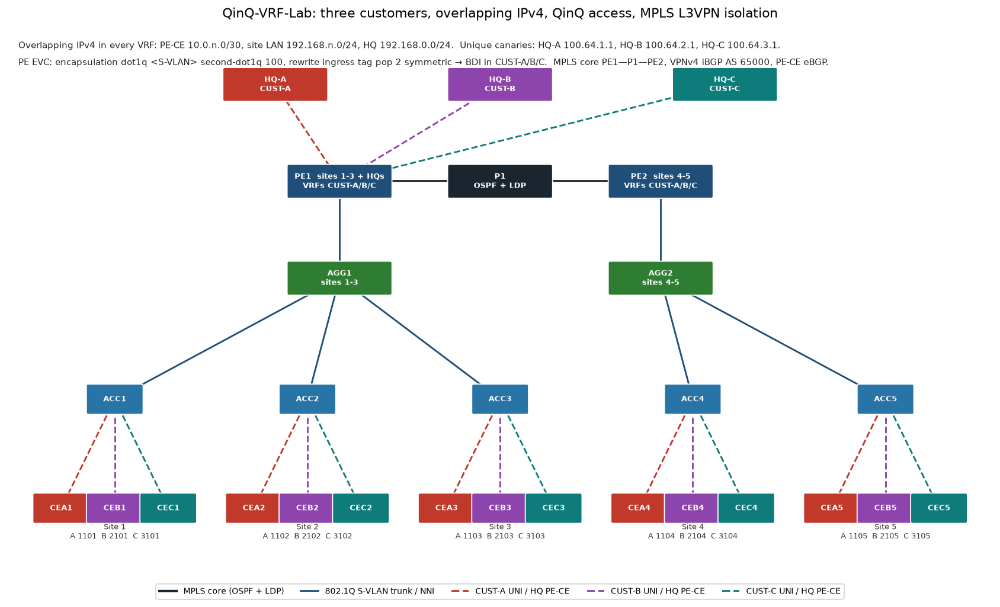

# QinQ + MPLS L3VPN lab (three customers, overlapping IPv4)

This page is a public summary of a separate Cisco Modeling Labs practice lab. It uses 802.1Q tunneling (QinQ) at the access edge and terminates each customer onto its own MPLS L3VPN VRF, with the same IPv4 plan reused in every VRF. The CML files, startup, troubleshooting and solution configurations, workbook, grader and answer key are not published in this repository.



## Design

- **Three customers, three VRFs.** CUST-A, CUST-B and CUST-C each have a VRF on the provider edge (RD and route-target `65000:1`, `65000:2` and `65000:3`). Every customer reuses the same IPv4 plan: PE-CE `10.0.n.0/30`, site LAN `192.168.n.0/24`, headquarters LAN `192.168.0.0/24`. Isolation is proven with a unique canary `/32` on each HQ and by checking that those canaries never appear in another VRF.
- **Five edge sites.** Each site has an IOL-L2 access switch with three `switchport mode dot1q-tunnel` user ports (one per customer, each in its own S-VLAN) and a customer router per tunnel port. Sites 1–3 were kept rather than six so three customers still fit a 40-node Personal Plus license (28 licensed IOL nodes, about 28 GB of RAM).
- **Aggregation.** Two IOL-L2 switches bridge the S-VLANs. AGG1 feeds PE1 (sites 1–3); AGG2 feeds PE2 (sites 4–5). The S-VLAN topology is a loop-free tree with spanning tree off for the S-VLANs, because Rapid-PVST on IOL-L2 produced topology-change storms in earlier builds.
- **QinQ termination on the PE.** Each site and customer is an Ethernet Flow Point that matches `dot1q <S-VLAN> second-dot1q 100`, applies `rewrite ingress tag pop 2 symmetric`, and lands on a BDI in the correct VRF. Headquarters routers attach to PE1 as routed PE-CE interfaces in their VRFs (no QinQ on those links).
- **MPLS core.** PE1, P1 and PE2 run OSPF and LDP in the global table. The PEs speak VPNv4 iBGP to each other in AS 65000. PE-CE routing is eBGP, and the site and HQ autonomous-system numbers are reused in every customer VRF, just like the IPv4 plan.

The lab ships in three states: a build-from-scratch start (customer LAN and PE-CE addresses only; the provider side is unbuilt), a troubleshooting copy with planted provider faults and a symptom-style ticket guide, and a solved copy used to validate the grader.

## Why IOL

IOL-L2 accepts `switchport mode dot1q-tunnel` and the CML dataplane carries double-tagged frames. IOL-L2 has no selective QinQ or VLAN mapping, so IOL-XE EVCs do the S-tag plus C-tag match and the pop onto a VRF BDI. IOL nodes need about 1 GB each, so 28 licensed nodes stay well inside a 40-node license.

## Verification

The lab guide and the read-only grader check `show dot1q-tunnel`, `show interfaces trunk`, `show ethernet service instance`, `show mpls ldp neighbor`, `show bgp vpnv4`, VRF route-targets, PE-CE and inter-site pings in each VPN, and isolation pings for every customer pair (A–B, A–C, B–C).

## What is not in this repository

The CML YAML file, device configurations, workbook, grader and answer key are not committed here. This repository stays a small, rendered network-as-code example with no device passwords and no lab keys.

## Appendix — CLI config notes

Annotated snippets for every role in this lab. Commands that matter are explained in place. These are the patterns the grader looks for, not a substitute for the full start and solved configs.

Replace `n` with the site number (1–5). Customer A S-VLAN is `1100+n`; customer B is `2100+n`; customer C is `3100+n`. Do not publish a real device password.

### A. Access switch (`ACCn`) — `dot1q-tunnel` UNIs

```
no spanning-tree vlan 1101-1105,2101-2105,3101-3105
vlan 1101
vlan 2101
vlan 3101
!
interface Ethernet0/1
 switchport trunk encapsulation dot1q
 switchport trunk allowed vlan 1101,2101,3101
 switchport mode trunk
 switchport nonegotiate
 no shutdown
!
interface Ethernet0/2
 switchport access vlan 1101
 switchport mode dot1q-tunnel
 spanning-tree bpdufilter enable
 no cdp enable
 no shutdown
```

Ethernet0/3 is CUST-B (`210n`); Ethernet1/0 is CUST-C (`310n`).

| Command | What it does |
|---|---|
| `switchport access vlan 1101` | The **S-VLAN**. On a tunnel port this is the outer tag the switch pushes, not a customer VLAN. |
| `switchport mode dot1q-tunnel` | QinQ UNI. Ingress C-tagged frames get an S-tag; egress pops the S-tag only. |
| `spanning-tree bpdufilter enable` | Drops BPDUs on the UNI so a customer STP domain cannot influence the provider. |
| `switchport trunk allowed vlan …` | Prune the uplink to this site's three S-VLANs. A missing S-VLAN on any trunk in the path takes only that customer at that site down. |

### B. Aggregation trunks

```
no spanning-tree vlan 1101-1105,2101-2105,3101-3105
interface Ethernet0/1
 switchport trunk encapsulation dot1q
 switchport trunk allowed vlan 1101,1102,1103,2101,2102,2103,3101,3102,3103
 switchport mode trunk
 switchport nonegotiate
```

That example is AGG1 toward PE1. AGG2 toward PE2 carries 1104-1105, 2104-2105, 3104-3105. Each ACC-facing port carries only that site's three S-VLANs. Rapid-PVST is off for the S-VLANs because IOL-L2 produced topology-change storms with it enabled.

### C. PE EVC: `second-dot1q` and `pop 2` onto a VRF BDI

```
vrf definition CUST-A
 rd 65000:1
 !
 address-family ipv4
  route-target export 65000:1
  route-target import 65000:1
 exit-address-family
!
interface Ethernet0/2
 no ip address
 no shutdown
 service instance 1101 ethernet
  encapsulation dot1q 1101 second-dot1q 100
  rewrite ingress tag pop 2 symmetric
  bridge-domain 1101
!
interface BDI1101
 vrf forwarding CUST-A
 ip address 10.0.1.1 255.255.255.252
 no shutdown
```

Repeat per site and customer, with CUST-B / `65000:2` / S-VLAN `210n` and CUST-C / `65000:3` / S-VLAN `310n`. Headquarters links on PE1 are routed interfaces in the VRF (no QinQ): Ethernet1/0, Ethernet1/1 and Ethernet1/2, each `10.0.0.1/30` in CUST-A, CUST-B and CUST-C.

| Command | What it does |
|---|---|
| `encapsulation dot1q 1101 second-dot1q 100` | Matches the provider S-tag and the customer C-tag together. A typo in either tag silently drops the PE-CE adjacency. |
| `rewrite ingress tag pop 2 symmetric` | Pops both tags into the bridge domain so the BDI sees an untagged IPv4 frame; `symmetric` pushes both tags on egress. Missing this, or using `pop 1`, breaks IPv4 on the BDI. |
| `vrf forwarding CUST-A` | The BDI (or HQ PE-CE interface) must be in the correct VRF. Apply the VRF *before* the IPv4 address. A BDI in the wrong VRF overlaps the reused PE-CE subnet of another customer. |
| `route-target import / export` | Must match between PEs for that customer. A typo isolates one VRF without affecting the others, or can leak a prefix into the wrong VRF. |

### D. MPLS core and VPNv4

```
mpls ldp router-id Loopback0 force
interface Ethernet0/1
 ip address 10.255.1.1 255.255.255.252
 mpls ip
!
router ospf 1
 router-id 10.255.0.1
 network 10.255.0.0 0.0.255.255 area 0
!
router bgp 65000
 no bgp default ipv4-unicast
 neighbor 10.255.0.2 remote-as 65000
 neighbor 10.255.0.2 update-source Loopback0
 !
 address-family vpnv4
  neighbor 10.255.0.2 activate
  neighbor 10.255.0.2 send-community extended
 exit-address-family
 !
 address-family ipv4 vrf CUST-A
  redistribute connected
  neighbor 10.0.1.2 remote-as 65101
  neighbor 10.0.1.2 activate
 exit-address-family
```

`mpls ip` is required on **both** ends of each core link. LDP missing on one interface leaves the IGP and even VPNv4 BGP up while labeled customer traffic fails. PE-CE `remote-as` and `activate` are per VRF address-family; an AS typo or a missing activate takes down only that one neighbor. Site `n` uses AS `6510n` and each HQ uses AS 65110, reused in every VRF.

### E. Isolation

Customer IPv4 is identical in every VRF, so a site address cannot tell customers apart. Prove isolation with the unique HQ canaries (`100.64.1.1`, `100.64.2.1`, `100.64.3.1`) and with `show ip route vrf CUST-A 100.64.2.1` (must not be in the table). Check all three pairs (A–B, A–C, B–C).
